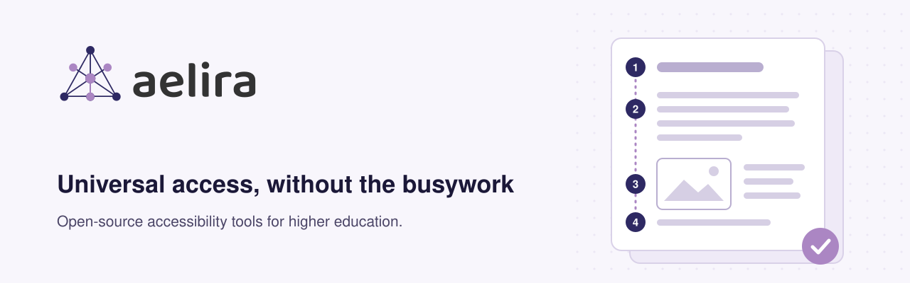

<h1 align="center">
  <picture>
    <source media="(prefers-color-scheme: dark)" srcset="assets/hero-dark.svg">
    <source media="(prefers-color-scheme: light)" srcset="assets/hero-light.svg">
    
  </picture>
</h1>

<p align="center"><strong>We build open-source tools that find accessibility problems in course content, fix what can be fixed safely, and show a person exactly what changed.</strong></p>

<p align="center">
  <a href="https://github.com/Aelira-AI/aelira-core/releases/latest"></a>
  <a href="https://github.com/Aelira-AI/aelira-core/blob/main/LICENSE"></a>
  <a href="https://github.com/sponsors/Aelira-AI"></a>
</p>

<p align="center">
  <a href="https://aelira.ai">Website</a> ·
  <a href="https://aelira.ai/docs">Docs</a> ·
  <a href="https://aelira.ai/us/blog">Blog</a> ·
  <a href="https://github.com/Aelira-AI/aelira-core/discussions">Discussions</a> ·
  <a href="https://github.com/Aelira-AI/aelira-core/blob/main/SECURITY.md">Security</a> ·
  <a href="https://github.com/sponsors/Aelira-AI">Sponsor</a>
</p>

Universities and colleges have to make course materials accessible, and most of that work is manual: opening PDFs one at a time, writing alt text, fixing tables and headings, captioning lectures. Aelira automates the parts that can be done reliably and keeps a person in charge of everything else. In the US, public institutions face WCAG 2.1 AA deadlines under the DOJ ADA Title II rule (26 April 2027 for entities serving 50,000 or more people, 26 April 2028 for smaller ones).

## Aelira Core

**[aelira-core](https://github.com/Aelira-AI/aelira-core)** is the whole product, free to self-host. It contains the FastAPI engine, the React dashboard and the [`@aelira/cli`](https://github.com/Aelira-AI/aelira-core/tree/main/cli) command-line client.

| Area | What you get |
|---|---|
|  **Scans** | PDF, Word, PowerPoint, Excel and LaTeX documents, web pages, audio and video. Severity comes from fixed rules, not a language model. |
|  **Remediates** | Format-specific fixes where the file exposes a safe target: tags, headings, tables, alternative text, OCR text layers, MathML and captions. Ambiguous cases stay open. |
|  **Connects** | Canvas, Brightspace, Blackboard and Moodle, plus Google Drive and Microsoft 365. Maturity differs by platform; check the [integration status table](https://github.com/Aelira-AI/aelira-core#lms-integration-status). |
|  **Records review** | A reviewer approves the exact saved file before it is published or written back, and evidence packages keep the scan results, decisions and file hashes together. |

```bash
git clone https://github.com/Aelira-AI/aelira-core.git
cd aelira-core
docker compose -f docker-compose.quickstart.yml up -d
```

That starts a scanner with AI turned off. You choose the AI provider, cloud or local through Ollama, and nothing is sent to a service you did not select. See the [quickstart](https://github.com/Aelira-AI/aelira-core#try-it-in-one-command) and the [self-hosting guide](https://github.com/Aelira-AI/aelira-core/blob/main/docs/deployment/self-hosting.md).

The engine and dashboard are AGPL-3.0 and the CLI is MIT. There is no paid feature tier. Hosted infrastructure and support are available through [aelira.ai](https://aelira.ai).

## Where things stand

Aelira Core is in **beta**. Some files still need manual work, and some cannot produce a downloadable remediated file. An automated score describes what our scanners found; it does not establish accessibility conformance. Review any remediated file before you publish it.

## How we build

We build in public, and that includes our mistakes. Every release ships notes that say what changed, what was not verified, and what operators need to do. When a claim in earlier notes turns out to be wrong, we add a dated correction rather than editing it away. Security advisories we cannot fix yet are listed with their reasoning and a review date.

- [Release notes](https://github.com/Aelira-AI/aelira-core/releases)
- [Security policy and reporting](https://github.com/Aelira-AI/aelira-core/blob/main/SECURITY.md)
- [Governance and maintainers](https://github.com/Aelira-AI/aelira-core/blob/main/GOVERNANCE.md)
- [Open issues](https://github.com/Aelira-AI/aelira-core/issues)

## Research direction

We want to measure how much AI actually helps accessibility practitioners: how faithful its output is to the source, how often it is wrong, and how long people spend checking it. Planned comparisons include general-purpose agents, specialised accessibility workflows and open-weight models trained further for the task. The longer-term aim is an accessibility specialist model, with evaluation tools, rights-cleared material and findings published openly.

## Get involved

| If you are... | Start here |
|---|---|
| Evaluating Aelira for an institution | [Quickstart](https://github.com/Aelira-AI/aelira-core#try-it-in-one-command) and [Discussions](https://github.com/Aelira-AI/aelira-core/discussions) |
| An accessibility practitioner | Tell us where the output falls short in [Discussions](https://github.com/Aelira-AI/aelira-core/discussions) |
| A developer | [Contributing guide](https://github.com/Aelira-AI/aelira-core/blob/main/CONTRIBUTING.md) and [developer onboarding](https://github.com/Aelira-AI/aelira-core/blob/main/docs/development/onboarding.md) |
| Reporting a problem | [Bug report](https://github.com/Aelira-AI/aelira-core/issues/new?template=bug_report.yml) or [feature request](https://github.com/Aelira-AI/aelira-core/issues/new?template=feature_request.yml) |
| Reporting a vulnerability | Follow the [security policy](https://github.com/Aelira-AI/aelira-core/blob/main/SECURITY.md); please do not open a public issue |

## Support the work

Aelira Core is free and stays free. [GitHub Sponsors](https://github.com/sponsors/Aelira-AI) funds maintenance, security work and the evaluation research. If sponsoring is not an option, a star, a bug report or telling another institution about the project helps too.

---

<p align="center">
  Founded by <a href="https://github.com/rdcrampton">RD (Reg) Crampton</a> ·
  <a href="https://aelira.ai">aelira.ai</a> ·
  <a href="https://www.linkedin.com/company/aelira-ai">LinkedIn</a> ·
  <a href="https://x.com/Aelira_dot_AI">X</a>
</p>
